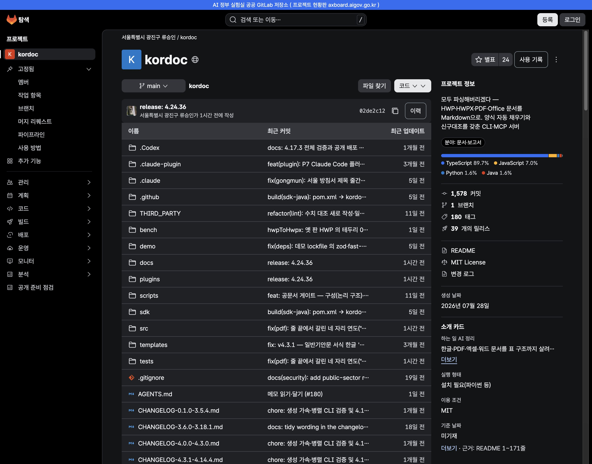

# 공공 깃랩

**KRDS 기반 공공 코드 저장소 화면**

[](https://hyunho2378.github.io/ai-public-gitlab/)
[](https://www.krds.go.kr/)

공공 깃랩은 AI 정부 실험실 공공 GitLab(gitlab.aigov.go.kr)의 공개 프로젝트를 행정안전부 범정부 UI/UX 디자인 시스템(KRDS)으로 다시 만든 웹 서비스입니다. 화면 구조와 기능 이름은 공공 GitLab과 같고, 그 위에 비전공 공무원이 만들어진 도구를 찾고 판단하도록 소개 카드, 업무 분야 분류, 업무 문장 검색, 공개 준비 점검을 덧붙였습니다.

개발자는 프로젝트 홈, 파일, 커밋, 브랜치, 머지 리퀘스트를 공공 GitLab과 같은 자리와 단축키로 씁니다. 프로젝트 목록과 상세 자료는 공공 GitLab 공개 API에서 불러옵니다.



| 구분 | 주소 |
| --- | --- |
| 공공 깃랩 | [hyunho2378.github.io/ai-public-gitlab](https://hyunho2378.github.io/ai-public-gitlab/) |
| 프로젝트 홈과 소개 카드 | [/projects/150](https://hyunho2378.github.io/ai-public-gitlab/projects/150) |
| 업무로 찾기 | [/search?q=출장비 계산](https://hyunho2378.github.io/ai-public-gitlab/search?q=%EC%B6%9C%EC%9E%A5%EB%B9%84%20%EA%B3%84%EC%82%B0) |
| 공개 준비 점검 | [/projects/150/publish-check](https://hyunho2378.github.io/ai-public-gitlab/projects/150/publish-check) |
| AI 코딩 도구 연결 | [/mcp](https://hyunho2378.github.io/ai-public-gitlab/mcp) |
| 원본 | [gitlab.aigov.go.kr](https://gitlab.aigov.go.kr) |

## 핵심 기능

- **프로젝트 둘러보기**: 공개 프로젝트 목록, 활성과 비활성 구분, 키워드 검색(3자 이상), 업무 분야 필터, 업데이트 날짜 정렬
- **업무로 찾기**: 업무 문장 검색 시 검색 결과 위에 관련 프로젝트 3개와 더보기 표시
- **소개 카드**: 프로젝트 홈 정보 열의 하는 일, 실행 형태, 이용 조건, 기준 날짜 4줄, 'AI 정리' 표시와 README 근거 줄
- **업무 분야 분류**: 표기가 섞인 주제를 하나의 분야 체계로 통합, 분야 필터 값 제공
- **공개 준비 점검**: .gitignore, README, 하는 일, 사용 방법, 실행 환경, 이용 조건, 시험 파일, 자동 점검 설정 8개 항목 점검, 보안 점검 상세는 제작자 전용
- **사용 기록**: 별표 옆 단추로 사용 기관, 날짜, 한 줄 메모 기록
- **요청 보드, 운영 현황판, 협업 모집**: 필요 도구 요청, 분야와 기관별 도구 분포, 같은 도구 제작 기관 연결
- **AI 코딩 도구 연결**: MCP 검색 도구(search_projects)와 연결 안내 화면
- **공공 GitLab 기본 화면**: 프로젝트 홈, 파일, 커밋, 브랜치, 태그, 릴리스, 작업 항목, 머지 리퀘스트, 파이프라인, 위키, 패키지, 멤버, 라벨, 마일스톤, 활동
- **개발자 동작**: 검색 `/`, 도움말 `?`, 파일 찾기 `t`, 파일 트리 `Shift+F`, 코드 메뉴(HTTPS와 SSH 복사, 압축 내려받기), 브랜치 검색, 나란히 비교
- **반응형**: 1920에서 360까지 5개 폭, 1200 미만 세로 바 서랍 전환
- **점검 중 자동 전환**: 공공 GitLab 점검 중 저장 자료로 자동 대체

소개 카드는 README 원문과 파일 목록에서 만들고 칸마다 근거 줄을 붙입니다. 화면별 구성과 기능 번호(F-01~F-39)는 [PRD.md](PRD.md)에 있습니다.

## 이용자별 화면

| 구분 | 비전공 공무원 | 개발자 |
| --- | --- | --- |
| 찾기 | 업무로 찾기, 업무 분야 필터 | 프로젝트, 그룹, 주제 탐색, 키워드 검색, 최근 검색 |
| 이해 | 소개 카드, 근거 줄, 기준 날짜 | README, 파일 표, 최근 커밋, 언어 비율 |
| 사용 | 실행 형태, 사용 방법, 사용 기록 | 코드 메뉴, 파일 찾기, 브랜치, 머지 리퀘스트 |
| 올리기 | 새 프로젝트 만들기 전 유사 도구 확인, README 표준 양식 | 공개 준비 점검, README 제안 |

## 디자인 시스템과 Figma

| 구분 | 내용 |
| --- | --- |
| 디자인 시스템 | KRDS v1.0.0 공식 CSS와 연결 CSS, 색·글꼴·간격·모서리·그림자 값을 KRDS 변수로 연결 |
| Figma 파일 | [AX.S] Public GitLab Rebuild_DS, 화면 56개, 변형 592개, product 부품 15종 |
| 프로토타입 | 흐름 A~K, 연결 1,103개 |
| 코드 대응 | Figma 부품 이름과 코드 이름표(`data-figma`) 일치 |
| 양방향 대조 | 화면 56개 × 폭 5개 × 로그인 2가지 = 560개의 요소 상자(x, y, 너비, 높이)를 1px 이내로 대조 |

```bash
npm run measure:full    # 코드 요소 상자 내보내기
npm run check:parity    # Figma 대조
npm run audit:code      # 코드 규칙 검사
```

## 빠른 실행

```bash
git clone https://github.com/hyunho2378/ai-public-gitlab.git
cd ai-public-gitlab/app
npm ci
VITE_STATIC=1 npm run dev   # http://127.0.0.1:5731
npm run build:pages         # GitHub Pages 빌드, 결과 app/dist
```

서버 없이 공공 GitLab 공개 API를 직접 불러와 화면이 열립니다. 로그인과 저장을 쓰는 서버판 실행, 환경 변수, 배포는 [docs/DEVELOPMENT.md](docs/DEVELOPMENT.md)에 있습니다.

## 폴더 구조

```text
app/            화면(React 18, Vite, 화면 파일, 공통 부품, KRDS 변수)
server/         기능 API(Node, Express, SQLite)
api/            API 계약(openapi.yaml)
data/           소개 카드와 분류 자료
sample/         예시 자료(공공 GitLab 공개 API 응답)
scripts/        카드 수집, 저장 자료 생성
UX/             화면 설계 문서, 대조 기록
code_plan/      Figma와 코드 대조 자료
figma_scripts/  Figma 내보내기와 수정 스크립트
figma_png/      Figma 화면 내보내기
screenshots/    배포본 화면 캡처
audits/         대조 원장
docs/           개발 안내, 이미지
```

## 문서

| 문서 | 위치 |
| --- | --- |
| 제품 정의(기능 F-01~F-39, 화면 목록) | [PRD.md](PRD.md) |
| 개발 안내(기술 스택, 실행, 서버, 인증, 배포) | [docs/DEVELOPMENT.md](docs/DEVELOPMENT.md) |
| UI 실행 규칙 | [UI.md](UI.md) |
| 화면 설계, 대조 기록 | [UX](UX) |
| API 계약 | [api/openapi.yaml](api/openapi.yaml) |
| 작업 기록 | [PROGRESS.md](PROGRESS.md) |

## 로드맵

| 시기 | 산출물 |
| --- | --- |
| 3차 활동 | 임베딩 업무 검색, 소개 카드 AI 생성, MCP 서버 연결, 공개 준비 점검 |
| 이후 | 법제처 연동 법령 변경 알림, 공공데이터 연결, 기관 인증 |

## 팀

**청년 공공 AX 서포터즈 2차 활동**

| 구분 | 구성 |
| --- | --- |
| 팀원 | 한은진, 장준호, 주현호, 김민우, 박만재 |
| 문의 | 저장소 이슈 |

## 출처

- 디자인 시스템: 행정안전부 [KRDS](https://www.krds.go.kr/), 공공누리 제1유형(출처 표시), 공식 HTML과 CSS 저작권 고지 유지
- 자료: AI 정부 실험실 공공 GitLab 공개 API
- 아이콘: KRDS 아이콘, 공공 GitLab Pajamas 아이콘(MIT)을 KRDS 규격으로 다시 그린 확장 아이콘, 파일 종류 아이콘 @gitlab/svgs(MIT)
- 로고: 행정안전부 공식 SVG
