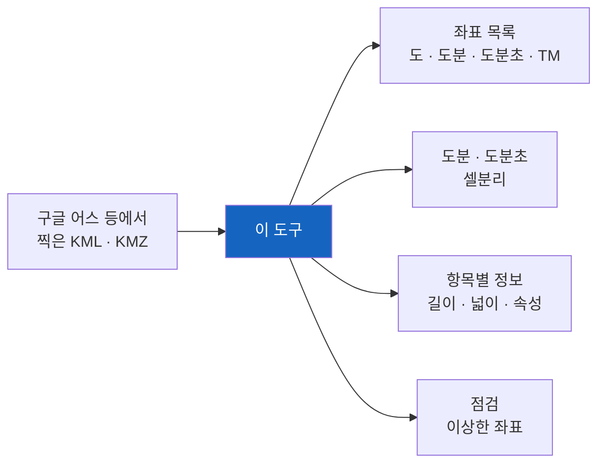

# KML-엑셀 변환 도구

[공공행정] 지도에 찍어 둔 좌표를 엑셀 표로 옮겨 주는 도구입니다.

구글 어스에서 해안선을 따라 점을 찍거나 구역을 그려 두면 KML 파일로 저장됩니다. 그 좌표를 공문이나 고시문에 넣으려면 사람이 하나씩 옮겨 적어야 합니다. 점이 수백 개면 하루가 갑니다. 이 도구는 그 일을 대신합니다.



**함께 쓰는 도구** — 반대 방향은 [엑셀 좌표-KML 변환 도구](https://gitlab.aigov.go.kr/park613/excel-coords-to-kml)가 합니다. 고시문이나 도면의 좌표표를 엑셀에 적어 넣으면 지도용 KML을 만들어 줍니다.

## 무엇이 나오는가

KML 하나에 엑셀 하나가 나옵니다. 시트는 넷이고, 살펴볼 곳이 있으면 점검 시트가 하나 더 생깁니다.

**좌표 목록** — 읽기 좋은 표입니다. 점 하나가 줄 하나입니다.

```
연번 | 위도(도)  | 경도(도)   | 위도(도분)    | 위도(도분초)    | TM X(N) [중부원점] | TM Y(E) [중부원점]
1    | 37.783966 | 125.613347 | 37° 47.0380' | 37° 47' 02.28" | 568,338.175       | 243,207.362
```

위도·경도는 도·도분·도분초 세 가지로, 평면직각좌표(TM)는 세계측지계 기준으로 함께 적습니다. 도면이나 설계 자료와 맞출 때 쓰시면 됩니다.

좌표 말고도 이름, KML 안 폴더, 모양, 순번, 높이를 읽습니다. 설명과 속성은 좌표 목록에 넣지 않고 항목별 정보 시트에 모읍니다. 다만 **값이 하나뿐인 칸은 넣지 않습니다.** 구역 하나만 그린 KML이면 좌표만 남아 깔끔하고, 도형이 여럿이면 이름과 모양 칸이 살아납니다. 어떤 칸을 뺐는지는 실행할 때 알려 줍니다.

항목이 여럿이면 이렇게 나옵니다.

```
연번 | 항목 | 이름    | 모양    | 순번 | 위도(도) | 경도(도)
1    | 1   | 포인트1 | 포인트  | 1/1  | 37.400   | 126.500
3    | 2   | 항로1   | 경로    | 1/36 | 37.400   | 126.500
4    | 2   | 항로1   | 경로    | 2/36 | 37.405   | 126.510
6    | 3   | 폴리곤1 | 폴리곤  | 1/33 | 37.380   | 126.480
```

| 칸 | 뜻 |
| --- | --- |
| 연번 | 파일 전체를 꿰뚫는 한 줄 번호 |
| 항목 | 같은 이름끼리 묶은 번호. 구멍 있는 폴리곤처럼 한 이름에 도형이 여럿이어도 한 항목입니다 |
| 순번 | 그 도형 안에서 몇 번째 점인지 / 모두 몇 점인지 |

**도분(셀분리) · 도분초(셀분리)** — 왼쪽에 이어 붙인 값, 오른쪽에 나눈 값을 둡니다. 앞뒤를 나란히 놓고 보시라고 이렇게 짰습니다.

```
연번 | 위도        | 경도         | 위도(도) | 위도(분) | 위도(초) | 경도(도) | 경도(분) | 경도(초)
1    | 37-47-02.28 | 125-36-48.05 | 37      | 47      | 02.28   | 125     | 36      | 48.05
```

분과 초는 10보다 작아도 앞에 0을 붙여 두 자리로 보입니다(`37° 00' 45.00"`). 고시문 서식이 그렇게 적기 때문입니다. 나눈 값은 숫자라 자리수를 바꾸거나 다시 계산할 수 있습니다. 왼쪽의 이어 붙인 값은 서식이 정해진 표에 그대로 복사해 넣으시라고 만들었습니다.

세 시트는 같은 **연번**으로 이어집니다. 항목이 여럿이면 항목 번호와 이름, 모양도 함께 따라와 어느 것의 좌표인지 바로 보입니다.

**항목별 정보** — 항목마다 한 줄로 길이와 넓이, 그리고 KML에 딸린 속성을 적습니다. 해안선을 따라 찍으셨으면 길이가, 구역을 그리셨으면 넓이가 바로 나옵니다.

```
항목 | 이름    | 모양   | 정점 수 | 길이(m)  | 길이(해리) | 넓이(㎡)   | 넓이(㎢) | 넓이(ha)
1    | 폴리곤1 | 폴리곤 | 33     | 31,479.6 | 16.998    | 46,402,827 | 46.403  | 4,640.28
3    | 트랙1   | 경로   | 36     | 31,691.1 | 17.112    |            |         |
```

길이는 미터와 해리로, 넓이는 제곱미터·제곱킬로미터·헥타르로 함께 적습니다.

**KML에 딸린 속성도 칸으로 펼칩니다.** 남의 기관에서 받은 KML에는 좌표 말고도 여러 정보가 들어 있습니다. 그것을 그대로 살려 적으므로 받은 KML이 곧 쓸 수 있는 대장이 됩니다.

```
항목 | 이름   | 모양   | ... | 면허번호 | 어업종류 | 어업방법 | 양식물   | 어장위치
1    | 마을176호 | 폴리곤 | ... | 176     | 마을어업 | 맨손    | 가무락  | 길상면 동검리지선
```

속성을 담는 방식 두 가지를 다 읽습니다. 속성 태그(ExtendedData)로 적은 것과, 설명란에 `1.구분 : 국가어항` 처럼 줄마다 적은 것입니다. 칸으로 풀리지 않는 설명은 `설명` 칸에 글자 그대로 남습니다.

속성은 항목마다 한 줄인 이 표에만 넣습니다. 좌표 목록에 넣으면 폴리곤 하나에 수십 줄이 같은 값을 되풀이해 표가 어지러워집니다.

칸 차례는 값이 많이 든 것부터입니다. 몇몇 항목에만 붙어 있는 속성은 오른쪽으로 밀리므로, 앞쪽 칸이 비어 보이는 일이 없습니다. 지구가 둥근 것을 셈에 넣어 재므로 어림이 아니라 실제 거리에 가깝습니다. 다만 **참고값**입니다. 고시나 등록에 쓰실 값은 측량 성과를 따르십시오.

**점검** — 살펴볼 곳이 있을 때만 생기는 시트입니다. 손으로 찍은 좌표에는 실수가 섞이기 마련이라, 이런 것을 짚어 줍니다.

- 우리나라 밖으로 나간 좌표 (위도와 경도가 뒤바뀐 경우가 많습니다)
- 앞뒤가 똑같은 점 (두 번 눌린 자리)
- 테두리가 닫히지 않은 폴리곤
- 점이 하나뿐인 경로

## 지도에 찍힌 좌표가 표가 됩니다

구글 어스나 앱에 그려 둔 자료를 공문이나 고시문에 넣으려면 좌표를 하나씩 옮겨 적어야 합니다. 이 도구가 그 일을 대신합니다. 위도·경도를 도·도분·도분초 세 가지로 적고 평면직각좌표(TM)도 함께 냅니다.

**넣은 것** — 지도에 찍어 둔 KML


**나온 것** — 좌표 목록 시트


## 설치 없이 쓰기 (컴퓨터를 잘 모르셔도 됩니다)

파이썬을 설치하지 않고 쓰는 방법이 있습니다. 저장소의 **릴리스(Releases)** 에서 `KML-엑셀 변환 도구(설치 없이 쓰는 묶음).zip` 을 내려받으십시오. 파이썬이 그 안에 들어 있어 여러분 컴퓨터에는 아무것도 깔리지 않습니다.

**[⬇ 묶음 내려받기 — 릴리스 페이지](https://gitlab.aigov.go.kr/park613/kml-to-excel/-/releases)** — 가장 최근 묶음이 맨 위에 있습니다.


1. 내려받은 압축 파일을 **오른쪽 버튼 → 압축 풀기** 로 풉니다. 바탕화면처럼 찾기 쉬운 곳이 좋습니다.
2. 풀린 폴더를 열면 `★ 먼저 읽어보세요.html` 가 맨 위에 있습니다. 두 번 누르면 인터넷 창으로 열립니다. 쓰는 차례를 그림으로 그려 두었고, 넣을 파일의 서식과 자주 막히는 곳까지 그 한 장에 담았습니다.
3. `input` 폴더에 바꿀 파일을 넣습니다.
4. `실행하기.bat` 을 두 번 누릅니다. 검은 창이 뜨고 진행 상황이 지나갑니다.
5. "엔터를 누르면 창이 닫힙니다" 가 나오면 엔터를 누릅니다.
6. `output` 폴더를 열면 결과가 들어 있습니다.

처음 실행할 때 **"Windows의 PC 보호"** 라는 파란 창이 뜰 수 있습니다. 인터넷에서 받은 파일이라 한 번 묻는 것입니다. **추가 정보** 를 누른 다음 **실행** 을 누르시면 됩니다. 다음부터는 묻지 않습니다.

폴더를 통째로 옮기거나 USB에 담아 다른 컴퓨터에서 쓰셔도 됩니다. 지우실 때는 폴더를 삭제하면 그만입니다. 레지스트리나 프로그램 목록에 남는 것이 없습니다.

> 파이썬을 이미 쓰고 계시거나 명령창이 익숙하시면 아래의 본래 방법이 더 가볍습니다. 묶음은 파이썬 본체까지 담고 있어 11MB쯤 됩니다.

## 쓰는 법

처음 한 번만 필요한 꾸러미를 받습니다.

```
pip install openpyxl
```

### 더블클릭으로 쓰기 (명령창을 모르셔도 됩니다)

1. KML이나 KMZ를 `input` 폴더에 넣습니다. 하위 폴더에 있어도 찾습니다.
2. `kml-엑셀 변환 도구.py` 를 더블클릭합니다.
3. `output` 폴더에 같은 이름의 엑셀이 생깁니다.

구글 어스에서는 자료를 오른쪽 버튼으로 누르고 "다른 이름으로 저장"을 고르시면 됩니다. KMZ는 압축본인데 도구가 알아서 풀어 읽으니 그대로 넣으셔도 됩니다.

### 명령창으로 쓰기

```
python "kml-엑셀 변환 도구.py" 파일.kml
python "kml-엑셀 변환 도구.py" 폴더 --합치기
```

`--합치기` 를 붙이면 여러 KML을 엑셀 한 파일로 모읍니다. 어느 파일에서 온 좌표인지는 첫 칸에 남습니다.

## 평면직각좌표(TM)

도면과 설계 자료는 위도·경도가 아니라 평면직각좌표를 씁니다. 그래서 좌표 목록에 `TM X(N)`, `TM Y(E)` 를 함께 적습니다. 세계측지계(GRS80) 기준이며, 나라에서 정한 네 원점 가운데 그 자리에 맞는 것을 경도로 골라 씁니다.

| 원점 | 중앙 경선 | 적용 경도 |
| --- | --- | --- |
| 서부 | 125도 | 126도보다 서쪽 |
| 중부 | 127도 | 126~128도 |
| 동부 | 129도 | 128~130도 |
| 동해 | 131도 | 130도보다 동쪽 |

한 파일이 한 원점 안에 들면 `TM X(N) [중부원점]` 처럼 열 제목에 적습니다. 서해처럼 원점 경계에 걸친 자료는 점마다 맞는 원점으로 계산하고 **원점** 칸을 따로 두어 어느 것으로 계산했는지 줄마다 밝힙니다.

세계측지계끼리의 셈이라 타원체를 바꾸는 계산이 없어 밀리미터까지 맞습니다. 되돌려 보는 시험에서 전국 어디서나 1밀리미터의 백분의 삼 안쪽으로 돌아옵니다. 다만 옛 동경측지계(베셀) 좌표와는 300미터 넘게 다르므로, 옛 도면과 맞추실 때는 그 도면이 어느 측지계인지 먼저 확인하십시오.

## 읽는 모양

구글 어스에서 찍는 세 가지를 모두 읽고, 모양 칸에 나눠 적습니다.

| 구글 어스에서 그린 것 | 엑셀의 모양 칸 |
| --- | --- |
| 포인트(장소표시) | 포인트 |
| 경로 | 경로 |
| 폴리곤(다각형) | 폴리곤 |
| 트랙 | 트랙 |

구글 어스에서 보시는 말 그대로 적습니다. 폴리곤에 구멍(도넛의 빈 곳)이 있으면 `폴리곤(바깥)` 과 `폴리곤(구멍1)` 로 나눠 적고, 구멍이 없으면 그냥 `폴리곤` 입니다.

트랙은 지나간 시각이 함께 적혀 있어 **지나간 시각** 칸이 따라옵니다. 배 항적을 저장해 표로 만들 때 쓰시면 됩니다. 경로 그리기로 그린 것은 트랙이 아니라 경로로 저장되므로 시각이 없습니다. 여러 도형이 묶인 것은 안으로 들어가 하나씩 폅니다. 폴더가 겹쳐 있으면 `위>아래` 로 적습니다.

## 저장소에 포함하지 않는 것

실제 자료와 만들어진 엑셀은 담지 않습니다. 서식을 보실 수 있도록 가상의 좌표로 만든 예시 KML만 넣어 두었습니다.

## 만든 곳

인천광역시 수산자원연구소

## 라이선스

아파치 라이선스 2.0입니다. 누구나 자유롭게 가져다 쓰고 고치고 다시 배포할 수 있습니다.

지켜 주실 것은 두 가지입니다. 저작권 표시와 라이선스 안내를 지우지 말고 함께 두시고, 고쳐서 배포하실 때는 어디를 바꾸었는지 밝혀 주십시오. 만든 곳 표시는 NOTICE 파일에 있습니다.
